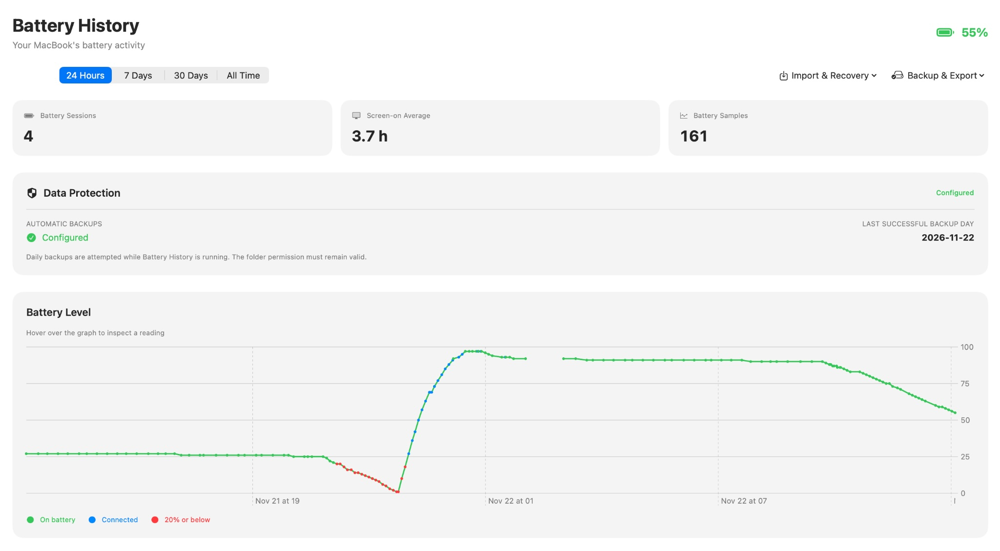

# Battery History 🔋

A native macOS menu bar app for exploring how your MacBook's battery changes over time. Battery History records discharge sessions, estimates screen-on time, and presents battery readings in an interactive SwiftUI dashboard.

> **Project status:** Early development / preview. The app is currently built and tested on an Apple silicon MacBook Air. Broader macOS compatibility and the restore workflow have not yet been fully tested.

## Features

- **Menu bar status:** Quickly see the current battery percentage and open the full dashboard.
- **Discharge sessions:** Track how long the Mac has been away from external power, including starting and ending battery percentage.
- **Approximate screen-on time:** Track screen-active intervals during monitored sessions, with gaps during system sleep excluded where possible.
- **Battery-level history:** Visualize timestamped battery percentages and power connection status with an interactive chart.
- **Date filters:** Switch between the last 24 hours, 7 days, 30 days, and all available data.
- **Session history:** Review completed sessions and their elapsed durations.
- **Historical recovery:** Import previously extracted battery readings and recover estimated sessions and screen-on time from macOS PowerLog-derived data.
- **Local backups and export:** Select a backup folder, create dated JSON/CSV backups, and export sessions to CSV. Automatic daily backup attempts occur while the app is running and a backup folder is configured.
- **Restore from backup:** A restore option is included, but **treat it as experimental until tested with disposable data**.

## Screenshots


## Requirements

- A Mac running macOS with SwiftUI and Swift Charts support (macOS 13 or later for Charts; newer macOS APIs may be required by the current source).
- Xcode with a compatible macOS SDK to build the project.
- A built-in battery for battery-specific monitoring.

The current development machine uses Apple silicon. Intel Mac support has not yet been verified.

## Build and run

1. Clone the repository:

   ```bash
   git clone https://github.com/kooino/BatteryHistory.git
   cd BatteryHistory
   ```

2. Open the `.xcodeproj` file in Xcode.
3. Select the macOS app scheme and **My Mac** as the destination.
4. Review signing settings and configure a development team if Xcode requires one.
5. Build and run with **⌘R**.

**Note for contributors:** The existing development bundle identifier is intentionally retained to preserve the author's locally stored history. If you change the bundle identifier for your own build, macOS may use a different sandbox container, and existing history will not automatically appear there. Never commit personal records to the repository.

## How tracking works

Battery History polls macOS power information while the app is running. It saves periodic battery percentage samples and records unplugged sessions. It uses display-activity sampling as an **approximation** of screen-on time rather than a system-provided authoritative Screen Time measurement.

The app can't continuously sample while the Mac is asleep or while the app isn't running. Historical PowerLog-derived records and screen-on estimates are inherently incomplete; coverage percentages help communicate how much supporting data was available. Some charging transitions during sleep may be uncertain.

**Important:** Automatic backups run only while the application is active. A configured backup folder does not guarantee a backup was completed on any given day.

## Local data and privacy

Battery History is designed to store its session and sample history **locally**, using the app's sandboxed Application Support directory. The app can also write backups to a directory you explicitly select.

- Recorded data may include timestamps, battery percentages, session durations, screen-on estimates, and power-connection status.
- Exported CSVs and backup JSON files may reveal usage patterns. Keep them private unless you intentionally choose to share them.
- No cloud syncing or analytics service has been intentionally added to this project at this stage. This is a description of the current intended design, **not** a completed third-party security audit.
- macOS PowerLog import tools operate on user-provided extracted data. Do not upload raw PowerLog databases or generated history files to GitHub.

## Backups and restore

Use **Backup & Export → Choose Backup Folder** to select a location for backups. You can also manually create a backup or export a CSV of recorded sessions.

The backup feature stores copies of `sessions.json`, `batterySamples.json`, and `sessions.csv` under dated subfolders. Restore is intended to replace the current history with the selected backup, while preserving a safety copy of the previous data. **Do not test restore against your only copy of important history.**

## Contributing

Bug reports and contributions are welcome after the public repository opens. Please include the macOS version, Mac model, Xcode version (if building from source), steps to reproduce, and any relevant error messages. **Remove usernames, home directory paths, battery history JSON, and PowerLog data from diagnostic attachments.**

## License

Licensed under the [MIT License](LICENSE).

## Roadmap

- Test backup restoration safely and improve recovery safeguards.
- Improve error handling and onboarding for first-time users.
- Verify additional macOS versions and Mac hardware configurations.
- Add screenshots, a custom app icon, and a downloadable signed/notarized build.
